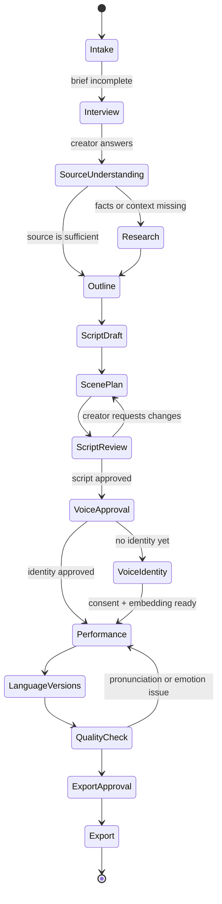

# Vivarisu AI — Producer Agent Architecture

## Product shape

Vivarisu AI is one **Producer Agent** with two surfaces:

1. **Agent workspace:** chat-first interface where the creator gives the agent a movie, story, notes, and direction. The agent explains what it is doing and shows tool calls.
2. **Manual studio:** a visual workspace where the creator edits scenes, emotional direction, voice identity, language versions, and final approvals.

The agent can do the production work, but the creator can take over any stage.

## System diagram

```mermaid
flowchart LR
    creator[Creator]

    subgraph frontend[Next.js Producer Workspace]
        chat[Agent chat UI\nmessages + tool trace]
        studio[Manual studio\nscenes + emotion + approvals]
        player[Audio/video preview]
    end

    subgraph backend[FastAPI Agent Server]
        api[API + WebSocket gateway]
        graph[LangGraph Producer Agent\nstateful workflow]
        memory[(Project memory\nbrief + decisions + history)]
        queue[Job queue\nlong audio/video jobs]
        policy[Guardrails + approval gates]
    end

    subgraph tools[Agent tool registry]
        ingest[ingest_source]
        ask[ask_creator]
        research[research_story]
        outline[build_story_outline]
        script[write_script]
        scenes[plan_scenes]
        emotion[direct_emotion]
        qa[check_script]
        dub[prepare_dub]
        subtitles[make_subtitles]
        assemble[assemble_episode]
        publish[prepare_youtube_package]
    end

    subgraph gnani[Gnani speech layer]
        prisma[Prisma STT\nvoice notes → text]
        embed[Voice embedding\nauthorised identity]
        clone[vachana-vc-v1\ncloned narration]
        timbre[Timbre TTS\nemotion-directed narration]
    end

    subgraph media[Media pipeline]
        ffmpeg[FFmpeg\njoin scenes + silence + music]
        assets[(Object storage\naudio + exports)]
        youtube[YouTube upload or\nmanual publish package]
    end

    creator --> chat
    creator --> studio
    chat <--> api
    studio <--> api
    api <--> graph
    graph <--> memory
    graph --> policy
    graph --> queue
    graph --> tools

    ingest --> prisma
    ask --> chat
    research --> memory
    outline --> memory
    script --> memory
    scenes --> emotion
    emotion --> qa
    qa --> policy
    dub --> timbre
    dub --> clone
    subtitles --> media
    assemble --> ffmpeg
    publish --> youtube

    prisma --> memory
    embed --> clone
    timbre --> ffmpeg
    clone --> ffmpeg
    ffmpeg --> assets
    assets --> player
    assets --> publish
```

## Agent state

LangGraph keeps one durable project state rather than treating every chat message as an isolated request:

```text
ProjectState
├── project_id
├── title
├── source_files
├── source_text
├── creator_brief
│   ├── audience
│   ├── mood
│   ├── angle
│   ├── spoiler_policy
│   └── target_languages
├── research_notes
├── script_draft
├── scenes[]
│   ├── script
│   ├── speaker
│   ├── emotion
│   ├── intensity
│   ├── pace
│   ├── cues
│   └── approval_status
├── voice_identity
├── language_versions[]
├── tool_trace[]
├── approvals[]
└── export_status
```

## Agent graph



## Tool contracts

| Tool | Purpose | Human approval |
|---|---|---|
| `ingest_source` | Accept title, text, file, or voice note | No |
| `ask_creator` | Ask missing creative questions in chat | No |
| `research_story` | Collect context and separate fact from theory | Before factual claims are used |
| `build_story_outline` | Create hook, beats, reveal, and interpretation | Recommended |
| `write_script` | Draft the narration in the target language | Yes |
| `plan_scenes` | Split script into scene and speaker units | Yes |
| `direct_emotion` | Assign emotion, pace, intensity, and cues | Yes |
| `transcribe_voice_note` | Call Gnani Prisma | No |
| `create_voice_identity` | Call Gnani voice embeddings | Explicit consent required |
| `synthesize_scene` | Call Timbre or cloned TTS | After scene approval |
| `prepare_dub` | Adapt script and reuse narrator identity | Yes before generation |
| `make_subtitles` | Create subtitle timing/text | No, review before publish |
| `assemble_episode` | Join audio, silence, music, and visuals | Yes before export |
| `prepare_youtube_package` | Create title, description, chapters, and tags | Yes before publish |

## How Gnani is used meaningfully

Gnani is the speech and voice layer inside a larger production agent:

- **Prisma:** creator’s Kannada/Hinglish voice notes become editable material. Context hints improve names, movie titles, and rare terms.
- **Voice embeddings:** an authorised narrator can create a reusable voice identity.
- **Timbre:** each approved scene is generated with the scene’s emotion, pace, pauses, and voice direction.
- **Voice-cloned TTS:** the narrator identity can be reused for a target-language version.

Vivarisu’s unique layer is the orchestration: it knows which speech tool to call, when to ask the creator, how to keep a consistent emotional arc, and when to stop for approval. It is not a second copy of the Gnani playground.

## Chat and studio interaction

### Chat handles intent

Example:

> “Make scene three less dramatic and let the reveal breathe.”

The agent translates that into a tool plan:

```json
{
  "tool": "direct_emotion",
  "scene_id": "scene-03",
  "changes": {
    "intensity": "medium",
    "pace": "slow",
    "pause_before_reveal": true
  },
  "requires_approval": true
}
```

### Studio handles precision

The creator can manually edit the same state through:

- Scene cards and script text.
- Emotion/intensity/pace controls.
- Character and narrator mapping.
- Pronunciation terms.
- Voice sample and consent status.
- Language-version comparison.
- Preview, approve, regenerate, and export controls.

Both surfaces update the same `ProjectState`.

## Recommended implementation order

1. Keep the current mock UI as the interaction contract.
2. Add a real LangGraph state machine behind `/api/agent/message`.
3. Add a tool registry with typed Pydantic inputs/outputs.
4. Persist `ProjectState` in SQLite first, PostgreSQL later.
5. Stream agent messages and tool events over WebSocket or Server-Sent Events.
6. Connect Prisma, voice embeddings, Timbre, and cloned TTS through backend-only adapters.
7. Add approval gates before voice generation and export.
8. Add FFmpeg jobs and object storage for finished episodes.

## Security boundaries

- Gnani keys stay on the backend.
- Voice embeddings are treated as sensitive and tied to explicit consent.
- Tool calls are schema-validated and logged.
- Research and generated facts are visibly separated in the UI.
- Final script, voice, and export require creator approval.
- The agent cannot publish directly without a final human confirmation.
